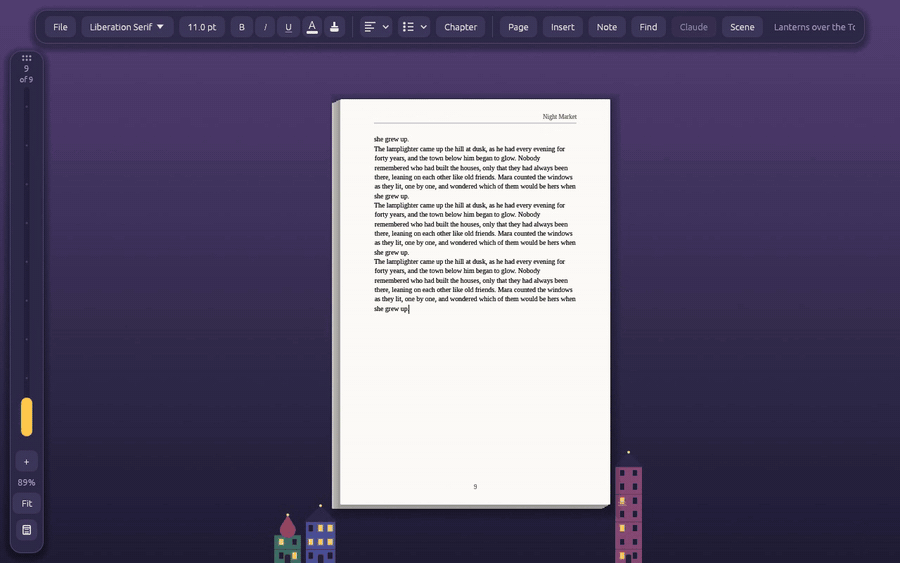
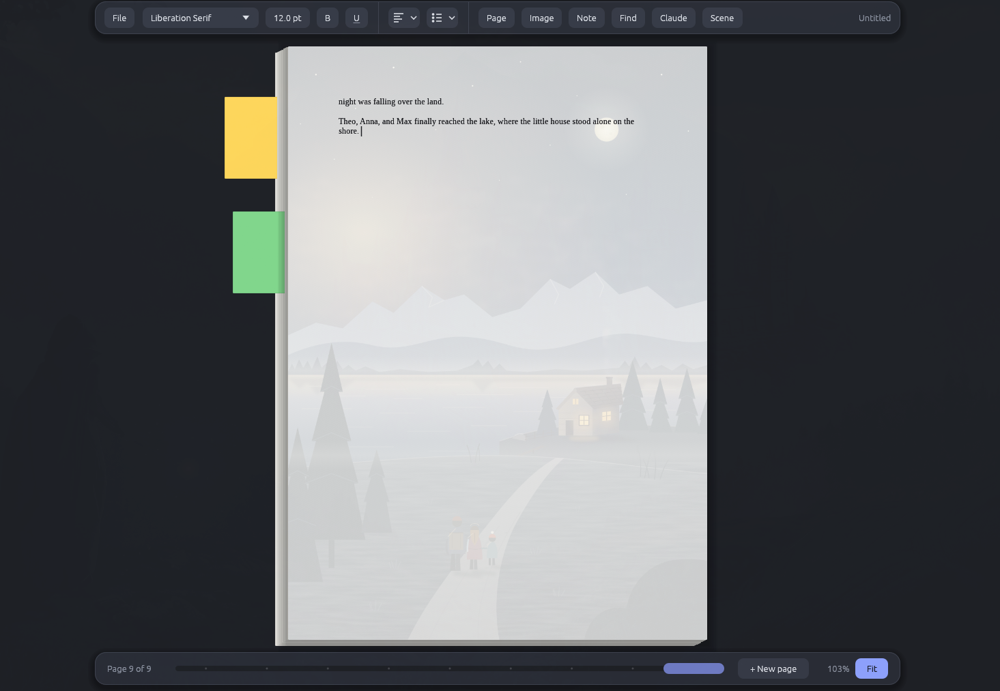

# Caprice Web

**A word processor for creative, fun story telling, in the browser.**

Open it at **https://caprice-web.caprice-web-checks.workers.dev**. Nothing to install: it runs in
Chrome, Edge or Brave, on a computer or a phone.

Caprice is for writing stories, not reports. It gives you real pages that turn like a book's or
slide onto a stack, post-it notes for your ideas, and Claude as a helper that paints the scene you
are writing behind the page. Caprice Web is a copy of the desktop app, built for WebAssembly: the
same app, drawing on the page's canvas.



*In the Magic City a street of houses grows with the story, a floor for every page. Make a line a
chapter title, and a dragon brings it in.*



## Why Caprice

- **Easy to use.** One small toolbar, real pages and no clutter. Start typing, and the story fills page after page.
- **A welcome to come back to.** Caprice greets you with a page of its own: begin something new, or pick up one of your stories, each shown with its first page, its first words, how many words it holds and when you last had it open. Choose one and its sheet flies onto the desk and becomes the page.
- **Joy in writing.** Pages turn over like a book's, or slide onto a stack (Page → View: *Book* or *Paperstack*). Under Page → Theme the desk comes in seven moods (*Midnight Ink*, *Lagoon*, *Marmalade*, *Disco Grape*, *Bubblegum*, *Pistachio Sorbet* and *Typewriter*) and seven magic ones, where something grows with your story: a garden, a city, ships in a bay, a forest of lanterns, a coral reef, a snowy hillside of Christmas trees, a vineyard.
- **Room for ideas.** Stick post-its to any line for plot twists, names and "what if…" thoughts. They peek out of the page piles, and clicking one takes you back to its page.

## Features

- **Begin a story as a kind.** A *Blank page*; a *Novel* on 6 × 9 in book pages, justified, with chapter titles, drop caps and page numbers, starting at "Chapter One"; a *Manuscript* in typewriter type, double spaced, to send out; or a *Journal* on A5 with today's date as its first title.
- **Scenes behind the page.** Describe a place ("a village between the mountains and the sea, at dusk") and Claude paints it faintly behind your writing; parts of it move, a dragon's wings gliding, smoke rising from chimneys, clouds drifting. Every scene is kept with its part of the story, and the picture changes as your caret moves on. In the browser this needs signing in, and for now Caprice paints 10 scenes a day for everyone together.
- **Your stories in any browser.** Stories are kept in your browser. Sign in with Google and each one also has a copy online, so the same stories are there on your phone and your computer. A story changed in two places is kept twice, never written over.
- **One story on several devices.** Open a story on your computer and your phone at once: one writes, the other follows every word as it is typed, and "Transfer here" moves the pen.
- **On a phone** the page fills the width and scrolls, a tap puts the caret in and brings the keyboard, a finger swiped sideways turns a page, and two pinch to zoom.
- **Post-it notes** on any selection or line (Ctrl+Alt+N), in several colours.
- **Pictures** in your text that you can move, resize and rotate.
- **Page numbers**, headers and footers, text boxes, chapters with drop caps.
- **Formatting** that stays out of the way: fonts, sizes, bold, italic, underline, text colour, alignment, lists and page setup; the brush copies formatting from one place to another.
- **Search and replace** (Ctrl+F, Ctrl+H), with match case and whole words.
- **Document info**: words of the story, the chapter and the selection, its versions, and the words written today towards a daily goal.
- **Your work is safe.** A saved story saves itself half a minute after each change, and when you switch tabs or apps. Every story, saved or not, keeps earlier versions of itself: go back to one under File → Versions.
- **Files in and out.** Download a story as a `.caprice` file and upload it again, export it to Word (.docx), or save the pages as a PDF and print them, looking just as they do on screen.

The desktop app has a few things the browser does not have yet: circling a passage with the pen to
ask Claude about it, the cast's model sheets, and having Claude paint along as you write.

## Building it

Caprice is written in Rust on egui/eframe. The native build runs the tests; the browser build is
WebAssembly with threads, on a nightly Rust named in `web/build.sh`.

```sh
cargo test                       # the tests, headless
cargo run --release              # the app on the desktop, keeping its files apart from desktop Caprice's
web/build.sh                     # the browser build, into web/dist
node web/serve.mjs 8080          # serve it with the headers its threads need: http://localhost:8080/
node web/smoke.mjs out/          # headless Chromium through the app, with screenshots (cd web && npm install first)
```

The server behind sign-in, stories online and scenes is a Cloudflare Worker (`web/api`), tested with
`cd web && node --test api/api.test.mjs`. `ARCHITECTURE.md` explains how the code fits together, and
the rules every change keeps.

## Files

Stories are saved as `.caprice` files: plain JSON holding the text, notes, pictures, the scenes
behind the pages and the cast. In the browser they are kept in the browser's own storage
(IndexedDB), with their versions and your settings; signed in, a copy of each story is kept online.
